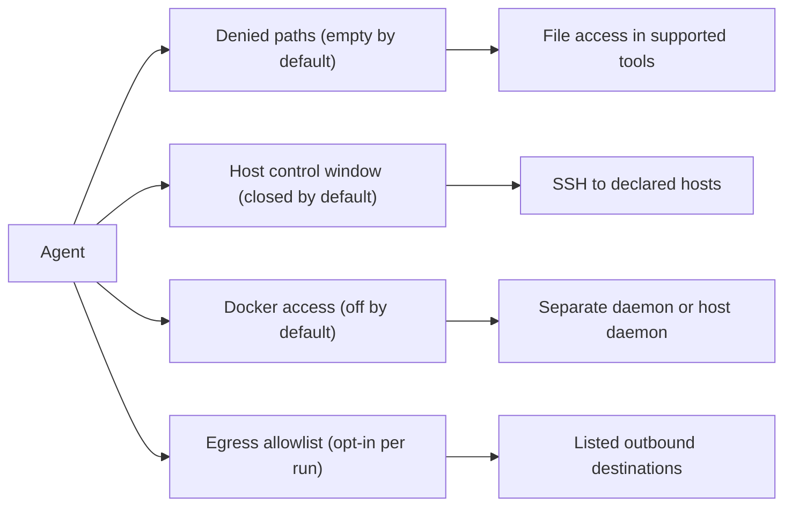
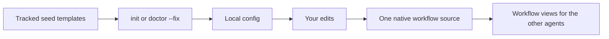
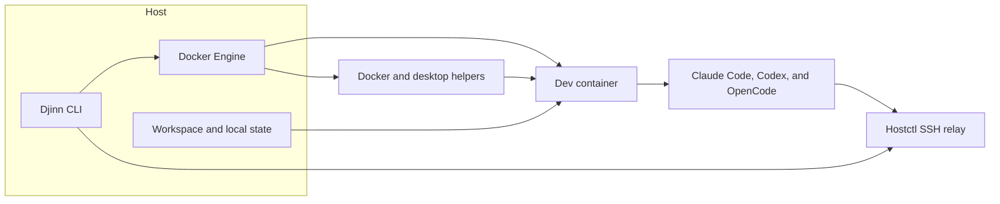

# Djinn in a Box

[](https://github.com/w2kr1stn/djinn_in_a_box/actions/workflows/ci.yml)
[](LICENSE)
[](pyproject.toml)

```text
⠀⠀⠀⠀⠀⠀⠀⠀⠀⠀⠀⠀⠀⡀⢀⣤⣀⡀⠀⠀⠀⠀⠀⠀⠀⠀⠀⠀⠀⠀
⠀⠀⠀⠀⠀⠀⠀⠀⠀⠀⠀⣴⣿⣷⠀⠻⣿⣿⣦⠀⠀⠀⠀⠀⠀⠀⠀⠀⠀⠀
⠀⠀⠀⠀⠀⠀⠀⠀⠀⠀⠀⣿⠟⢁⣴⣦⣈⠻⠿⠀⠀⠀⠀⠀⠀⠀⠀⠀⠀⠀
⠀⠀⠀⠀⠀⠀⠀⠀⠀⠀⠀⢠⣾⣿⣿⣿⣿⣷⡄⠀⠀⠀⠀⠀⠀⠀⠀⠀⠀⠀
⠀⠀⠀⠀⠀⠀⠀⠀⠀⠀⠀⠀⠻⣉⡀⢀⣉⠟⠀⠀⠀⠀⠀⠀⠀⠀⠀⠀⠀⠀
⠀⠀⠀⠀⠀⠀⠀⠀⣠⣤⣶⣶⣦⡈⠃⠘⢁⣴⣶⣦⣤⣀⠀⠀⠀⠀⠀⠀⠀⠀
⠀⠀⠀⠀⠀⠀⣴⣿⣿⡿⠿⠿⠿⣷⡀⢀⣠⣤⣤⣤⣤⣄⣁⠀⠀⠀⠀⠀⠀⠀
⠀⠀⠀⠀⠀⣼⣿⣿⣿⣷⣶⣶⠦⠀⢀⡈⠛⠿⣿⣿⣿⣿⣿⣷⣄⠀⠀⠀⠀⠀
⠀⠀⠀⠀⠀⠉⠙⠛⠉⢉⣁⣤⣴⣾⣿⣿⣷⣦⣤⣈⡉⠙⠛⠛⠉⠀⠀⠀⠀⠀
⠀⠀⠀⠀⠀⠀⠀⠀⠀⠀⢻⣿⣿⣿⣿⣿⣿⣿⣿⣿⠃⠀⠀⠀⠀⠀⠀⠀⠀⠀
⠀⠀⠀⠀⠀⠀⠀⠀⠀⠀⠀⠿⢿⣿⣿⣿⣿⠿⠟⠛⠀⠀⠀⠀⠀⠀⠀⠀⠀⠀
⠀⠀⠀⠀⠀⠀⠀⠀⠀⠀⢀⣶⣤⣤⣤⣤⣤⣴⡶⠀⠀⠀⠀⠀⠀⠀⠀⠀⠀⠀
⠀⠀⠀⠀⠀⠀⠀⠀⣀⣴⣿⣿⣿⣿⣿⣿⣿⡿⠁⠀⠀⠀⠀⠀⠀⠀⠀⠀⠀⠀
⠀⠀⠀⠀⠐⠲⠿⢿⣿⣿⣿⣿⣿⣿⡿⠟⠋⠀⠀⠀⠀⠀⠀⠀⠀⠀⠀⠀⠀⠀
⠀⠀⠀⠀⠀⠀⠀⠀⠀⠈⠉⠉⠉⠀⠀⠀⠀⠀⠀⠀⠀⠀⠀⠀⠀⠀⠀⠀⠀⠀

██████╗      ██╗██╗███╗   ██╗███╗   ██╗
██╔══██╗     ██║██║████╗  ██║████╗  ██║
██║  ██║     ██║██║██╔██╗ ██║██╔██╗ ██║
██║  ██║██   ██║██║██║╚██╗██║██║╚██╗██║
██████╔╝╚█████╔╝██║██║ ╚████║██║ ╚████║
╚═════╝  ╚════╝ ╚═╝╚═╝  ╚═══╝╚═╝  ╚═══╝
            ─── in a box ───
```

Djinn in a Box runs coding agents in a Docker dev environment you can rebuild without signing in again.

It bundles Claude Code, Codex, and OpenCode so you can use the same tools across projects.
Coding agents run commands in the container, where Djinn mounts your configured workspace and each agent's own state,
not your whole home directory.

## What's in the box

### A dev shell you can come back to

Open a shell with `djinn start`. Use `djinn start --detach` to keep it running after you close the terminal.
Use `djinn enter` when one terminal turns into two.
The dev container can relay desktop notifications and audio, and it can host [remote agent sessions](docs/remote-agent-servers.md).

### One prompt, one container

Try `djinn run claude "Explain this project structure."` from a project directory.
Djinn starts a separate container with your workspace, sends the prompt, and cleans up when the task ends.
The bundled agents default to their read-only mode where available. Use `--write` to request edits.

### Reusable workspaces

Give longer work a name with `djinn session --project my-project --create`.
Djinn keeps the files under `~/.djinn/sessions/` so you can reopen the workspace or send it another prompt.

### A check before you start

Run `djinn doctor` before you blame the agent. It checks Docker, the local config, the image, and the
expected files, names the failing check, and repairs missing local directories and seed files with `--fix`.

### Persistent sign-ins and backups

Each tool keeps its own sign-in state outside the image, so rebuilding the container leaves it in place.
`djinn backup` saves credentials and selected data in an encrypted archive by default.
Use `djinn restore` to bring them back. Djinn also supports persistent age identities and an optional SOPS key mount.

### Access you can control

Denied paths (`denied_paths` in `config.toml`) make Claude Code and Codex refuse supported tool calls to the folders you list.
This protects against accidental access. Deliberate evasion remains possible. Host control windows grant time-limited SSH access.
A dev session can use a separate Docker daemon, or you can explicitly grant access to the host daemon.
For a one-shot run, `djinn run --allow` restricts outbound connections to the destinations you list.
See [the controls and their limits](docs/access-and-boundaries.md).



### Blank space for your workflow

The repository ships neutral seeds. Opinions are user-supplied.
Djinn copies missing files into your local, Git-ignored `config/` directory. From then on they are yours.
Keep instructions, skills, agents, and commands in one agent's native layout.
`djinn config sync` derives matching views for the other two. Hooks stay with their own tool.



### Runtime Packages

Install supported Debian packages with `apt-get` inside the container.
Djinn records successful installs so it can replay them when a new container starts.
A human can remove a recorded entry with `sudo` as shown in [package usage and persistence](docs/storage-and-recovery.md#runtime-packages).
See also the [runtime package install security model](SECURITY-MODEL.md#runtime-package-installs).

## How it fits together

Run the `djinn` CLI on the host. Docker starts the dev container with the workspace and selected local state mounted.
Optional helpers handle desktop relays, separate Docker access, and time-limited SSH.



## Quickstart

Install [Docker, Compose, Buildx, and uv](docs/getting-started.md#requirements) on the host first.

```sh
git clone https://github.com/w2kr1stn/djinn_in_a_box.git djinn-in-a-box
cd djinn-in-a-box
uv tool install --editable .
djinn init
djinn build
djinn doctor
djinn start
```

### First Authentication

Sign in to each tool inside the dev shell. Codex uses `codex login --device-auth`.
See the [sign-in steps](docs/getting-started.md#first-authentication).

Agent-guided setup is planned in [#29](https://github.com/w2kr1stn/djinn_in_a_box/issues/29).

## Go deeper

The README stays short on purpose. The rest lives here.

- [Getting started](docs/getting-started.md) for prerequisites, installation, and sign-in.
- [Configuration](docs/configuration.md) for declared mounts, resources, and seeds.
- [Agents and workflow](docs/agent-workflow.md) for presets, shared instructions, and MCP.
- [Running Djinn](docs/running-djinn.md) for shells, guest runs, and sessions.
- [Headless cheat sheet](docs/headless-cheatsheet.md) for prompts and options.
- [Access and security boundaries](docs/access-and-boundaries.md) for paths, SSH, Docker, and egress.
- [Remote agent servers](docs/remote-agent-servers.md) for browser and remote clients.
- [OpenCode 2](docs/opencode-v2.md) for settings, themes, providers, and plugins.
- [Storage and recovery](docs/storage-and-recovery.md) for mount behavior, Git signing, and backups.
- [Sync across machines](docs/sync-across-machines.md) for shared and host-local state.
- [Diagnostics and maintenance](docs/operations.md) for doctor, audit, and updates.
- [Suite integration](docs/suite-integration.md) for applications that launch Djinn sessions.
- [CLI design system](docs/design/CLI_DESIGN_SYSTEM.md) for terminal output conventions.

## License

Djinn in a Box uses the [MIT License](LICENSE).
